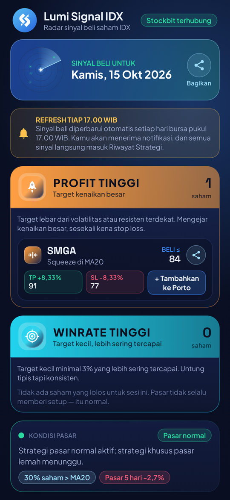
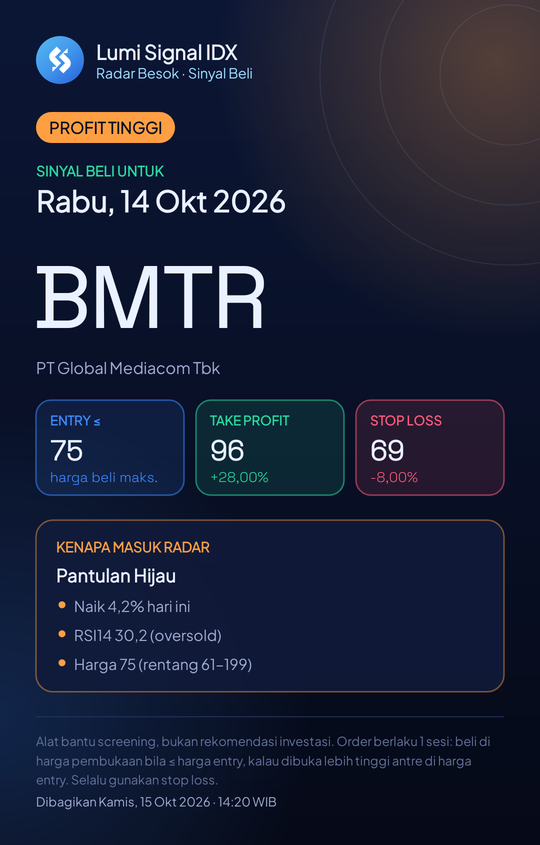
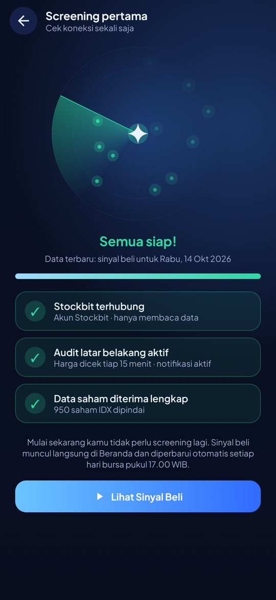
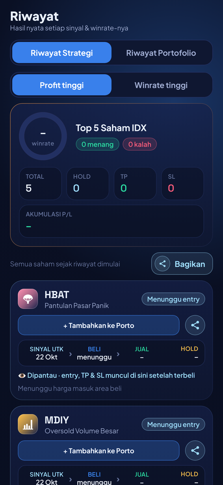
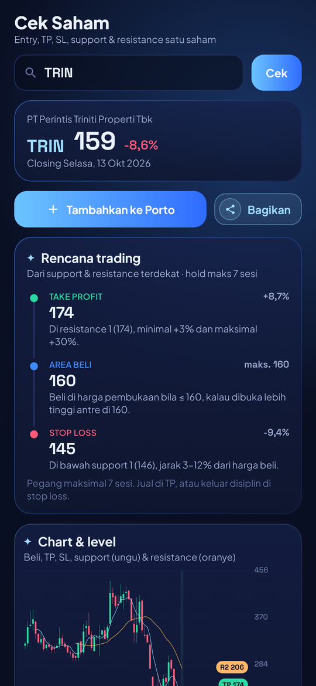
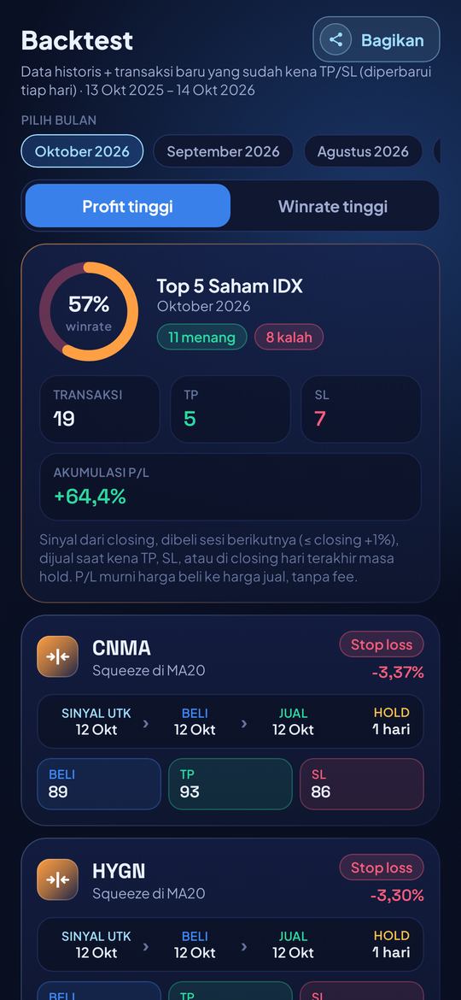
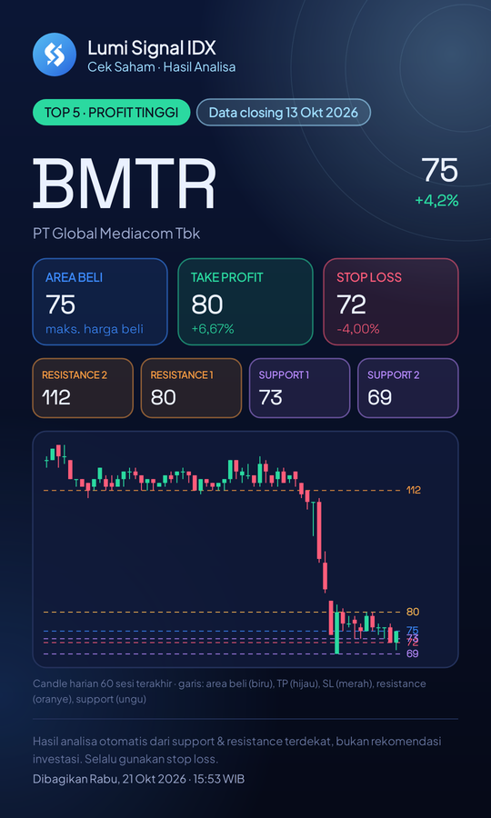
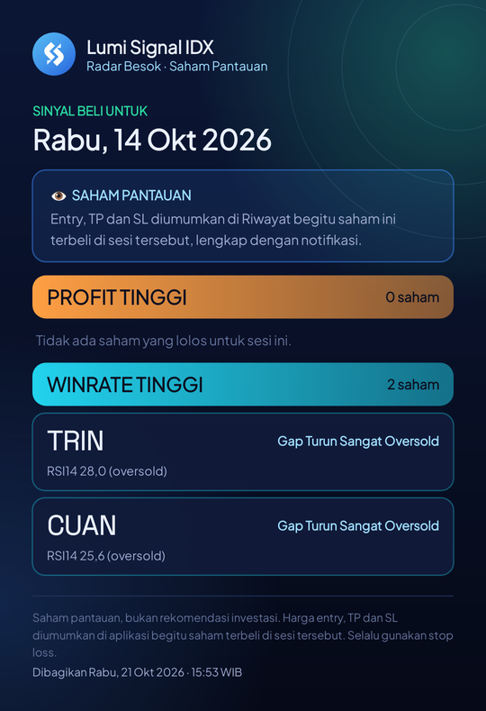

<div align="center">

# ✦ LumiSignal ✦

### Radar sinyal beli saham Bursa Efek Indonesia untuk Android

*Top 5 saham pantauan setiap hari bursa pukul 17.00 WIB · entry, TP & SL diumumkan saat terbeli · audit harga tiap 1 menit*

[](https://github.com/vickyvam72/LumiSignal/releases/latest)
[](#-kebutuhan-sistem)
[](#%EF%B8%8F-teknologi)
[](LICENSE)
[](#-kenapa-lumisignal)

**🌐 Bahasa / Language:** &nbsp; **🇮🇩 Bahasa Indonesia** &nbsp;|&nbsp; [🇬🇧 English](README.en.md)

[⬇️ Unduh](#%EF%B8%8F-unduh--pasang) · [📸 Tampilan](#-tampilan) · [✨ Fitur](#-fitur) · [📖 Panduan](#-panduan-pemakaian) · [❓ FAQ](#-faq--mengatasi-masalah) · [📝 Catatan Perubahan](CHANGELOG.md)

</div>

---

## 🌟 Kenapa LumiSignal?

> **Lumi Signal IDX** memindai closing semua saham BEI setiap hari bursa, lalu menyajikan **Top 5 saham pantauan untuk sesi berikutnya**. Begitu saham benar-benar terbeli, **harga entry, take profit, dan stop loss diumumkan** di Riwayat lengkap dengan notifikasi, lalu **diaudit tiap 1 menit dengan harga asli** sampai kena TP atau SL. Jadi angka yang kamu lihat selalu angka nyata.

| | |
|---|---|
| 🕔 **Pantauan tiap 17.00 WIB** | Saham pantauan untuk sesi besok muncul otomatis di Beranda, lengkap dengan **notifikasi tepat pukul 17.00**. Tidak perlu screening ulang. |
| 🚀 **Profit Tinggi & 🎯 Winrate Tinggi** | Dua jenis sinyal dalam satu halaman: target kenaikan besar, atau target kecil yang lebih sering tercapai. |
| 📐 **Entry, TP & SL saat terbeli** | Harga entry asli, take profit, dan stop loss muncul **begitu saham terbeli**, dibulatkan sesuai **fraksi harga BEI**, dan dikirim lewat notifikasi. |
| ⏱️ **Audit tiap 1 menit** | Setiap sinyal masuk **Riwayat Strategi** dan dicek **tiap 1 menit selama jam bursa, juga saat aplikasi ditutup**. |
| 💼 **Portofolio pribadi** | Tandai saham yang benar-benar kamu beli. TP dan SL dihitung ulang dari harga belimu sendiri. |
| 🧪 **Backtest per bulan** | Hasil strategi sejak Oktober 2025, **bertambah otomatis setiap hari** dengan transaksi baru yang sudah kena TP atau SL. |
| 📊 **Cek Saham** | Analisa satu saham: rencana entry, TP & SL, **2 support & 2 resistance**, dan chart, **bisa dibagikan sebagai gambar**. |
| 🖼️ **Laporan siap dibagikan** | Bagikan saham pantauan, riwayat, backtest, atau hasil analisa sebagai **gambar** yang rapi, otomatis jadi beberapa halaman kalau panjang. |
| 🔒 **Hanya membaca data** | Akun Stockbit dipakai untuk membaca harga saja. Aplikasi **tidak pernah membuat order**. |

---

## 📸 Tampilan

<div align="center">

| 🏠 Beranda | 🖼️ Bagikan sebagai gambar |
|:-:|:-:|
|  |  |
| **Buka aplikasi, pantauan sudah menunggu.** Top 5 Profit Tinggi dan Winrate Tinggi untuk besok, tiba setiap hari pukul **17.00 WIB**. Entry, TP & SL menyusul **begitu saham terbeli**. | **Satu ketukan, langsung siap dikirim.** Tanggal beli, kode saham, dan **kenapa saham itu masuk radar**, rapi dalam satu gambar untuk grup atau teman. |

| 📡 Screening pertama | 📜 Riwayat |
|:-:|:-:|
|  |  |
| **Cukup sekali seumur aplikasi.** Radar berputar sambil memastikan Stockbit terhubung, audit latar belakang aktif, dan **data ratusan saham diterima lengkap**. | **Bukan janji, tapi bukti.** Setiap sinyal diaudit dengan **harga asli** sampai kena TP atau SL. Winrate dan akumulasi P/L terlihat apa adanya. |

| 📊 Cek Saham | 🧪 Backtest |
|:-:|:-:|
|  |  |
| **Penasaran dengan satu saham?** Ketik kodenya dan dapatkan rencana entry, TP & SL, plus **2 support dan 2 resistance** langsung di chart. | **Uji strategi sebelum percaya.** Hasil setiap bulan sejak Oktober 2025, **bertambah sendiri setiap hari** dengan transaksi yang sudah selesai. |

| 🧾 Bagikan hasil analisa | 📋 Semua pantauan hari ini |
|:-:|:-:|
|  |  |
| **Analisa satu saham, siap dikirim.** Area beli, TP, SL, **2 support & 2 resistance**, dan chart 60 sesi dalam satu gambar. | **Seluruh pantauan besok dalam satu kiriman.** Profit Tinggi dan Winrate Tinggi, lengkap dengan alasan masuk radar. |

</div>

---

## ✨ Fitur

### 🏠 Beranda
- **"Sinyal beli untuk [tanggal]"**: yang ditampilkan selalu tanggal beli, bukan tanggal closing, supaya tidak salah paham
- **PROFIT TINGGI** dan **WINRATE TINGGI** dengan judul berwarna mencolok, masing-masing berisi Top 5 saham
- Setiap saham: kode, strategi, tanda **👁 Dipantau**, tombol **bagikan**, dan **Tambahkan ke Porto**
- **Entry, TP & SL belum ditampilkan** di Beranda. Angka itu baru muncul di Riwayat begitu saham terbeli, supaya yang kamu lihat selalu harga nyata
- Pengingat **"Refresh tiap 17.00 WIB"** dan kartu kondisi pasar
- Tombol **Bagikan** untuk mengirim semua sinyal hari itu dalam satu gambar

### 🔔 Otomatis setiap hari bursa
- Pukul **17.00 WIB** aplikasi mengambil saham pantauan terbaru, **langsung memasukkannya ke Riwayat Strategi**, lalu mengirim **notifikasi**
- Harga diaudit dengan high & low harian asli **tiap 1 menit selama jam bursa, juga saat aplikasi ditutup** (tanpa bunyi dan tanpa ikon di status bar)
- Notifikasi **"✅ terbeli di …"** lengkap dengan **entry, TP, dan SL**, lalu notifikasi lagi saat kena **TP atau SL**
- **Rekap setiap sore** setelah pasar tutup: berapa saham hold, kena TP, kena SL, dan akumulasi P/L
- **Token Stockbit diperbarui otomatis setiap hari**, jadi tidak perlu sering login ulang

### 📜 Riwayat
- **Riwayat Strategi**: semua sinyal sejak aplikasi dipasang, dengan total, hold, TP, SL, winrate, dan **akumulasi P/L**
- **Riwayat Portofolio**: saham yang kamu tandai sendiri
- Setiap kartu menampilkan alur **SINYAL UTK › BELI › JUAL › HOLD**, plus Entry, TP, dan SL setelah terbeli

### 🧪 Backtest
- Pilih bulan dari **Oktober 2025** sampai bulan berjalan
- Transaksi, TP, SL, akumulasi P/L, dan daftar sahamnya
- **Bertambah otomatis setiap hari** dengan transaksi live yang sudah kena TP atau SL

### 📊 Cek Saham
- Ketik kode saham untuk melihat rencana **entry, TP & SL**
- **2 support dan 2 resistance** digambar langsung di chart
- Langsung terlihat apakah saham itu sedang masuk Top 5
- Tombol **Tambahkan ke Porto**

### 🖼️ Bagikan sebagai gambar
| Yang dibagikan | Isinya |
|---|---|
| Satu saham pantauan | Tanggal beli, kode saham, dan **kenapa masuk radar** |
| Semua pantauan hari itu | Profit Tinggi & Winrate Tinggi dalam satu gambar |
| Hasil Cek Saham | Harga, area beli, TP, SL, **2 support & 2 resistance**, dan chart 60 sesi |
| Satu riwayat | Kode, entry, TP, SL, **P/L**, tanggal beli & tanggal jual |
| Laporan Riwayat Strategi | Pilih **dari tanggal – sampai tanggal**: total transaksi, TP, SL, akumulasi P/L, dan tabel kode · beli · jual · hold · **entry** · TP · SL · P/L |
| Laporan Portofolio | Semua posisi porto dalam format yang sama |
| Laporan Backtest | Pilih **satu bulan**, format yang sama |

Semua dikirim **hanya sebagai gambar**, tanpa teks tambahan. Laporan yang panjang otomatis dipecah menjadi beberapa halaman.

---

## ⬇️ Unduh & Pasang

1. Buka halaman **[Releases](https://github.com/vickyvam72/LumiSignal/releases/latest)**.
2. Di bagian **Assets**, unduh `LumiSignalIDX-v2.2.apk`.
3. Buka file yang sudah diunduh. Kalau Android meminta, izinkan **"Instal aplikasi tidak dikenal"** untuk browser atau pengelola file yang kamu pakai.
4. Tekan **Instal**. Selesai! 🎉

> 💡 **Update:** Cukup pasang APK baru di atas yang lama. Login, riwayat, dan porto tetap aman.

### 📋 Kebutuhan Sistem
- Android **8.0 (API 26)** atau lebih baru
- Akun **Stockbit** (hanya untuk membaca harga)
- Koneksi internet

---

## 📖 Panduan Pemakaian

### 0️⃣ Pertama kali dibuka
1. **Login Stockbit** di halaman login resmi Stockbit. Token hanya disimpan **di HP-mu**.
2. **Satu langkah lagi** (pas satu layar, tanpa scroll): izinkan **notifikasi**, kecualikan Lumi dari **penghemat baterai**, dan buka **Autostart / Mulai otomatis** (khusus Xiaomi, Oppo, Vivo, Realme, Infinix).
3. **Mulai Screening** (cukup sekali): animasi radar sambil memeriksa bahwa Stockbit terhubung, audit latar belakang aktif, dan data saham diterima lengkap. Tekan **Lihat Sinyal Beli**.

Setelah itu Beranda selalu langsung menampilkan sinyal beli terbaru.

### 1️⃣ Membaca sinyal
- Saham di Beranda adalah **pantauan** untuk sesi yang tertulis di kartu tanggal.
- Begitu saham itu **terbeli** di sesi tersebut, kamu mendapat notifikasi **"✅ SMGA terbeli di 82 · TP 91 · SL 77"**, dan angka yang sama muncul di Riwayat.
- Kalau harga tidak pernah turun ke batas beli selama sesi itu, sinyal **batal**.
- Saham yang masih dipegang tidak direkomendasikan lagi.

### 2️⃣ Tambahkan ke Porto
Tekan **+ Tambahkan ke Porto** di kartu saham. Isi harga belimu kalau sudah membeli, maka TP dan SL langsung dihitung dari harga itu.

### 3️⃣ Membagikan laporan
- **Satu saham:** tekan ikon bagikan di kartunya.
- **Riwayat Strategi:** tekan **Bagikan**, lalu pilih **dari tanggal** dan **sampai tanggal**.
- **Portofolio:** tekan **Bagikan semua**.
- **Backtest:** tekan **Bagikan** di sebelah judul, lalu pilih bulan.

### 4️⃣ Reset data
Menu **Akun** → **Reset riwayat strategi** atau **Reset riwayat portofolio**.

---

## ❓ FAQ & Mengatasi Masalah

<details>
<summary><b>Notifikasi 17.00 terlambat atau tidak muncul</b></summary>

Pastikan notifikasi diizinkan, Lumi dikecualikan dari penghemat baterai, dan **Autostart** menyala (menu **Akun** → **Buka Autostart**). Izinkan juga **Alarm tepat waktu** di halaman izin (atau **Setelan → Aplikasi → Lumi Signal IDX → "Alarm & pengingat"**) supaya notifikasi tepat pukul 17.00.
</details>

<details>
<summary><b>Kenapa statusnya "Menunggu entry" atau "Batal"?</b></summary>

**Menunggu entry** berarti sesi beli belum berjalan. **Batal** berarti harga tidak pernah turun ke batas beli selama sesi itu, sehingga order tidak terisi. Sinyal batal tidak dihitung sebagai menang atau kalah.
</details>

<details>
<summary><b>Hari ini tidak ada sinyal baru</b></summary>

Pada hari libur bursa tidak ada closing baru. Kalau pasar sedang lemah, strategi juga bisa tidak menemukan saham yang lolos. Itu normal.
</details>

<details>
<summary><b>Diminta login Stockbit lagi</b></summary>

Token diperbarui otomatis setiap hari selama aplikasi berjalan setidaknya seminggu sekali. Kalau HP lama tidak dipakai, Stockbit bisa meminta login ulang.
</details>

<details>
<summary><b>Apakah aplikasi bisa membeli saham untukku?</b></summary>

Tidak. Lumi Signal IDX **hanya membaca data** dan **tidak pernah membuat order**. Semua keputusan jual-beli tetap di tanganmu.
</details>

---

## 🔒 Privasi

- ✅ **Tanpa** iklan, analitik, atau pelacak pihak ketiga
- ✅ Token Stockbit hanya disimpan **di HP-mu**, tidak pernah dikirim ke server lain
- ✅ Akses **hanya membaca**: tidak ada order, tidak ada transfer dana
- ℹ️ Data sinyal dan backtest diunduh dari repositori GitHub publik

---

## 🛠️ Teknologi

| Bagian | Teknologi |
|---|---|
| Bahasa | **Kotlin** |
| Tampilan | **Jetpack Compose**, Material 3 |
| Latar belakang | **Foreground service** (audit tiap 1 menit selama jam bursa), **AlarmManager** (pantauan 17.00 & audit mulai 08.50 WIB), dan **WorkManager** sebagai cadangan |
| Jaringan | OkHttp, kotlinx.serialization |
| Mesin radar | **Python** (pandas, NumPy) di GitHub Actions setiap hari bursa |
| Gambar laporan | Android Canvas, dibagikan lewat FileProvider |
| Pengujian | Robolectric + Roborazzi (screenshot tiap layar) |
| CI/CD | GitHub Actions: setiap push mem-build dan merilis APK |

### 📁 Struktur proyek
```
app/src/main/java/com/lumisignal/idx/
├── data/      # Klien Stockbit (read-only), model data, penyimpanan
├── engine/    # Radar, tracker TP/SL, support & resistance, fraksi harga
├── service/   # Monitor latar belakang, alarm 17.00, notifikasi
├── share/     # Gambar laporan yang dibagikan
└── ui/        # Beranda, Riwayat, Cek Saham, Backtest, Akun
tools/radar/   # Mesin screening & backtest (Python)
```

### 🏗️ Build dari kode sumber
```bash
git clone https://github.com/vickyvam72/LumiSignal.git
cd LumiSignal
gradle :app:assembleRelease   # Gradle 8.11.1, JDK 17
```
APK hasil build ada di `app/build/outputs/apk/release/`.

> 🔐 Build rilis ditandatangani dengan kunci pribadi yang disimpan di **GitHub Actions Secrets** (`LUMI_KEYSTORE_BASE64`, `LUMI_KEYSTORE_PASSWORD`). Kunci tidak pernah disimpan di repo. Untuk build lokal, taruh keystore milikmu di `keystore/lumisignal.jks` dan isi `LUMI_KEYSTORE_PASSWORD`.

---

## 🙏 Terima Kasih

LumiSignal bisa berdiri berkat layanan, proyek open-source, dan orang-orang berikut. **Terima kasih banyak!** 💖

### 📈 Data & pasar
| Untuk | Terima kasih kepada |
|---|---|
| Data harga harian untuk mesin radar | [**TradingView**](https://www.tradingview.com) |
| Harga live untuk audit sinyal dan porto | [**Stockbit**](https://stockbit.com) |
| Aturan fraksi harga dan sesi perdagangan | [**Bursa Efek Indonesia**](https://www.idx.co.id) |

### 📚 Library & alat
[Jetpack Compose](https://developer.android.com/jetpack/compose) · [AndroidX WorkManager](https://developer.android.com/topic/libraries/architecture/workmanager) · [Navigation Compose](https://developer.android.com/jetpack/compose/navigation) · [OkHttp](https://github.com/square/okhttp) · [kotlinx.serialization](https://github.com/Kotlin/kotlinx.serialization) · [Kotlin Coroutines](https://github.com/Kotlin/kotlinx.coroutines) · [pandas](https://github.com/pandas-dev/pandas) · [NumPy](https://github.com/numpy/numpy) · [websocket-client](https://github.com/websocket-client/websocket-client) · [Robolectric](https://github.com/robolectric/robolectric) · [Roborazzi](https://github.com/takahirom/roborazzi) · [GitHub Actions](https://github.com/features/actions)

### 🔤 Huruf
[Plus Jakarta Sans](https://github.com/tokotype/PlusJakartaSans) oleh Tokotype · [Space Grotesk](https://github.com/floriankarsten/space-grotesk) oleh Florian Karsten (SIL Open Font License)

### 💬 Dan untukmu
Terima kasih untuk semua yang sudah mencoba, menguji, memberi masukan, dan membagikan LumiSignal. Setiap laporan bug dan ide membuat aplikasi ini lebih baik. 🙌

> Layanan dan proyek di atas tidak berafiliasi dengan LumiSignal. Seluruh merek dagang dan penghargaan atas karya mereka menjadi milik pemiliknya masing-masing.

---

## ⚖️ Penafian

LumiSignal adalah proyek independen untuk **penggunaan pribadi dan edukasi**.
LumiSignal **bukan rekomendasi investasi** dan **tidak berafiliasi dengan, didukung oleh, atau disponsori oleh Stockbit, TradingView, maupun Bursa Efek Indonesia**.
Hasil backtest dan riwayat tidak menjamin hasil di masa depan. Harga saham bisa naik dan turun; selalu gunakan stop loss, atur ukuran posisi, dan ambil keputusan sendiri. Gunakan dengan risiko sendiri dan sesuai ketentuan layanan masing-masing penyedia data.

## 📄 Lisensi

Hak cipta © 2026 **vickyvam72**.

LumiSignal adalah perangkat lunak bebas dan open source, dirilis di bawah **[GNU General Public License v3.0](LICENSE)**.
Kamu boleh memakai, mempelajari, mengubah, dan membagikan ulang LumiSignal, dengan syarat versi turunannya juga dirilis dengan lisensi yang sama (GPL-3.0) dan kode sumbernya tetap terbuka.
LumiSignal diberikan **tanpa jaminan apa pun**. Lihat file [LICENSE](LICENSE) untuk teks lengkapnya (berbahasa Inggris).

<div align="center">

---

Dibuat dengan ❤️ di Indonesia · Kalau suka LumiSignal, beri ⭐ ya

</div>
